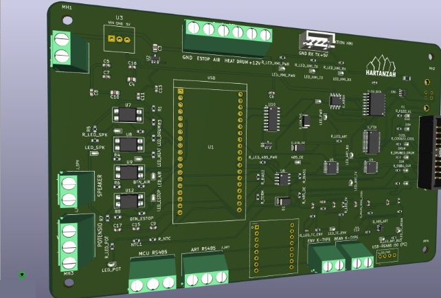
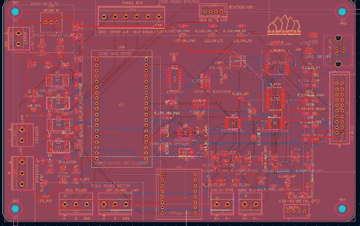
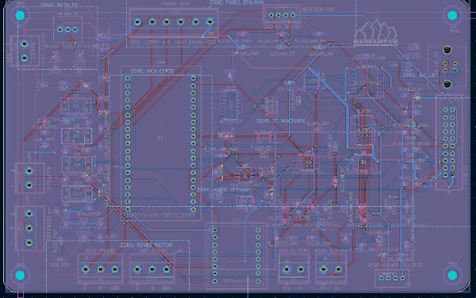

# D01E — electric drum roaster

Controller and two-board electronics for an electric drum roaster. Same class of machine as [Orion 05](https://github.com/byhabibi/orion-05): ESP32, Nextion HMI, roast curve, RoR, and Artisan over Modbus. This one heats with a 3.6 kW element instead of LPG, and the control electronics sit on PCBs I laid out.

## Machine

| Item | Value |
|---|---|
| Power | 220 V, single phase, 50 Hz |
| Heater | 3600 W |
| Drum motor | 12 V DC |
| Exhaust | 12 V fan, PWM |
| Cooling | two 12 V fans |
| HMI | Nextion NX8048K070, 7 inch |
| MCU seat | ESP32-DevKitC-32E |
| Thermocouples | MAX31856 breakout, bean and environment |

## What is in this repo

| Path | Contents |
|---|---|
| `firmware/` | ESP32 firmware. Roast pages, heater, air, cooling, Modbus Artisan |
| `docs/` | HMI notes, heater control, electrical design, I/O |
| `pcb/` | Two-board package: MAIN-CTRL and IO-PWR. Schematics, BOM, QC, Gerbers |

Firmware build, from `firmware/`:

```bash
pio run -t upload --upload-port COMx
```

Heater on the first PCB revision is on/off on GPIO13. Burst-fire for the later board is `-DHEATER_HW_V36=1` in `platformio.ini`.

## Mainboard

PCB-01 MAIN-CTRL, the logic board. These three views are the routed Fase 1 layout from KiCad: front copper, back copper, and the 3D model. The editor reported the board fully routed (no airwires left).

<p>



</p>

3D view, front copper, back copper.

DevKit sits in the middle (U1). Terminals along the edges take the panel, thermocouples, HMI, and the link to the power board. The Gerber set checked into `pcb/PCB-01_MAIN-CTRL/Gerbers/` is an older export and is marked not for fabrication. The pictures above are the layout to look at.

## Boards

Two boards, production phase 1:

- **PCB-01 MAIN-CTRL** — DevKit seat, fixed 5 V buck module, MAX31856 breakouts, HMI and panel I/O.
- **PCB-02 IO-PWR** — mains side: contactor, SSR, and the power path for the heater.

Schematic drawings are in `pcb/schematics/`. Open `pcb/schematics/INDEX.html`.

The Gerbers under `pcb/PCB-01_MAIN-CTRL/Gerbers/` are an older layout (soldered WROOM and a discrete buck). `DO_NOT_FAB_STALE.txt` in that folder is still true. The BOM and schematic seats are the ones to follow: DevKit, fixed 5 V module, MAX31856 breakouts. PCB-02 Gerbers still had DRC violations when this package was frozen. Do not send either set to a fab as-is.

## Scope

Firmware and the board design for this machine. Not a drop-in for the gas machines (Orion 05 and D03).
