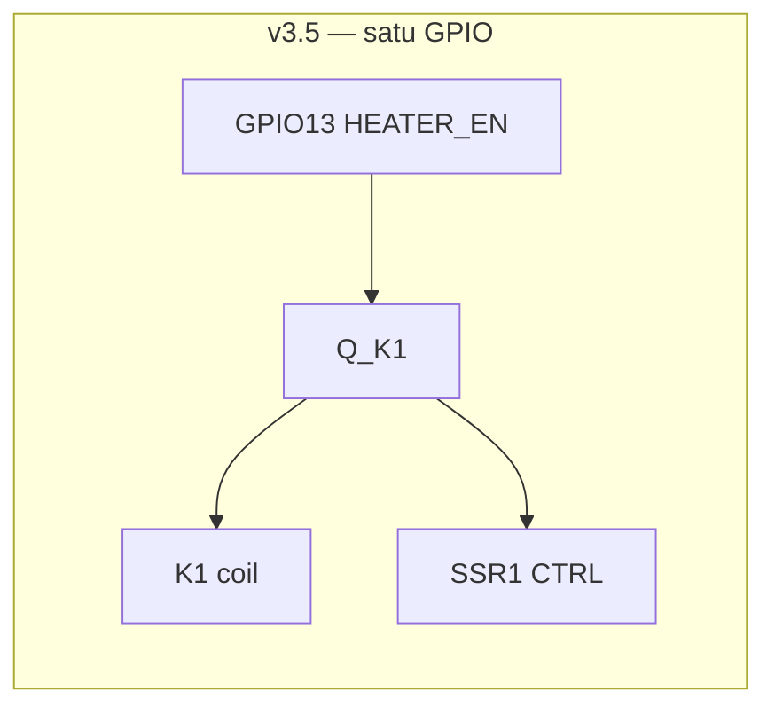
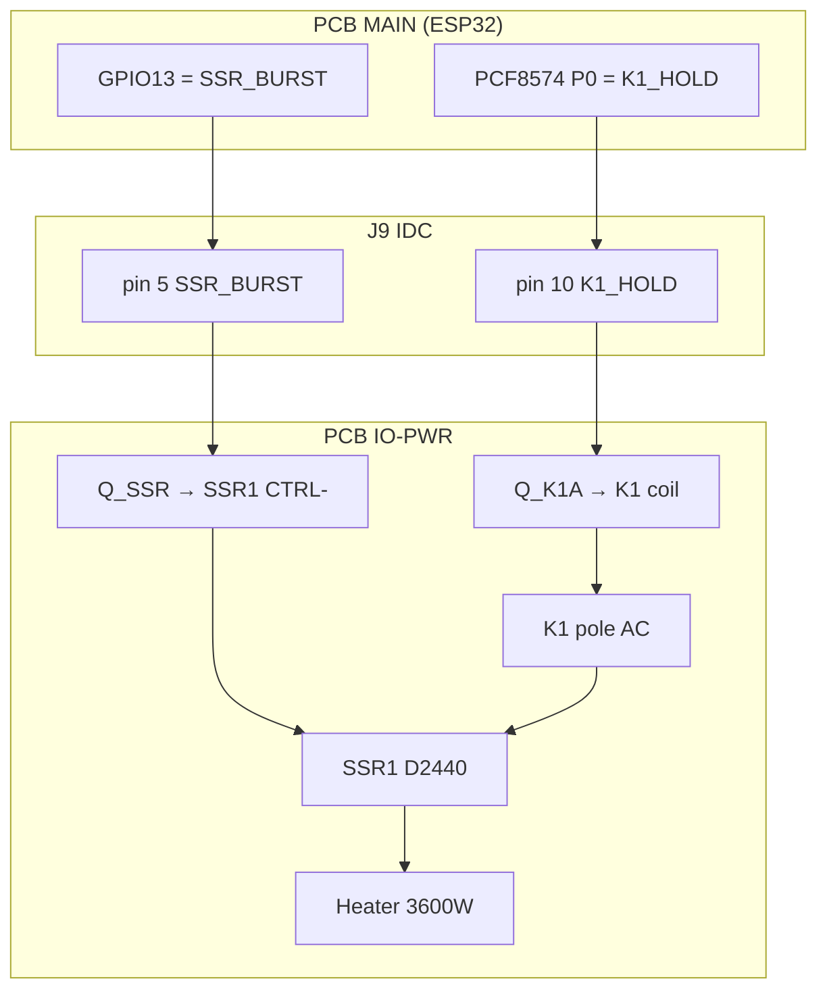
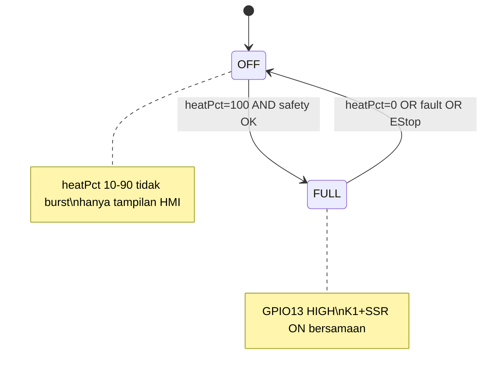
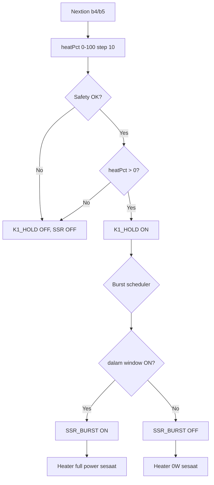
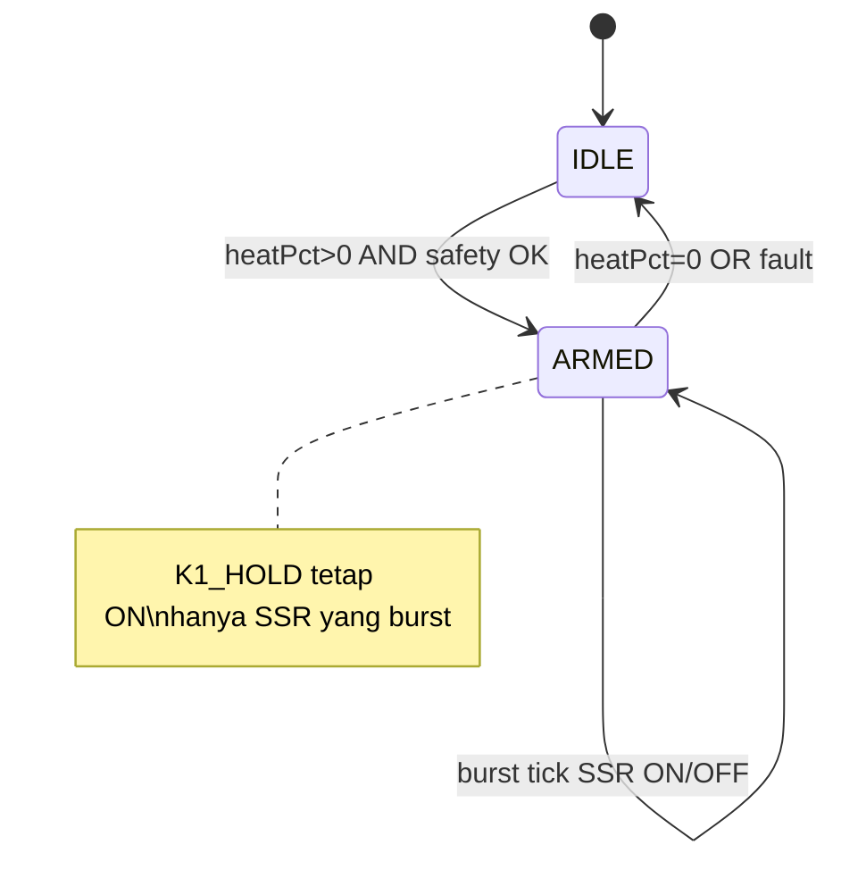

# D01E Heater Control — Revisi v3.6

**Tanggal:** 2026-07-11  
**Proyek:** Danish 01 Electric (D01E)  
**Tujuan:** Pisah kontrol **K1 contactor** vs **SSR burst fire** agar modulasi 0–100% aman dan awet.

---

## 1. Ringkasan masalah (v3.5)

Pada v3.5, satu sinyal **GPIO13 → HEATER_EN → Q_K1** menggerakkan **coil K1** dan **input kontrol SSR1** secara bersamaan.



| GPIO13 | K1 contactor | SSR1 | Heater AC |
|--------|--------------|------|-----------|
| LOW | BUKA | OFF | 0 W |
| HIGH | TUTUP | ON | 3600 W penuh |

**Burst fire di GPIO13** → K1 ikut buka-tutup setiap siklus → **tidak awet** untuk kontaktor mekanis.

---

## 2. Solusi v3.6 — dua sinyal terpisah

| Sinyal | GPIO / IO | Fungsi | Siklus |
|--------|-----------|--------|--------|
| **K1_HOLD** | PCF8574 **P0** → IDC pin **10** → **Q_K1A** | Coil kontaktor | ON selama `heatPct > 0` |
| **SSR_BURST** | **GPIO13** → IDC pin **5** → **Q_SSR** | Kontrol SSR | Burst fire 0–100% |



### 2.1 Diagram daya AC (tidak berubah)

```
L ──► SW5 ──► F4 ──► F1 25A ──► K1 (L1→T1) ──► SSR1 ──► Heater L
N ───────────────────────────────────────────────────────► Heater N
```

### 2.2 Diagram DC control v3.6

```
+12V (F3) ──► [E-Stop NC#2] ──► titik X
                                │
                    ┌───────────┴───────────┐
                    │                       │
              K1 A1 ◄┘                 SSR1 CTRL+ ◄┘
              K1 A2 ──► Q_K1A drain    SSR1 CTRL- ──► Q_SSR drain
                    │                       │
                    └─────── GND ───────────┘

Q_K1A gate ◄── 1kΩ ◄── IDC pin 10 ◄── PCF8574 P0 (MAIN)
Q_SSR gate ◄── 1kΩ ◄── IDC pin 5  ◄── GPIO13 (MAIN)

D_K1 (1N4007) flyback paralel coil K1 (katoda ke X, anoda ke A2)
```

### 2.3 Perilaku level heater

| heatPct | K1_HOLD | SSR_BURST | Daya rata-rata |
|---------|---------|-----------|----------------|
| 0% | OFF | OFF | 0 W |
| 10% | ON | ON 1s / OFF 9s per 10s | ~360 W |
| 30% | ON | ON 3s / OFF 7s per 10s | ~1080 W |
| 50% | ON | ON 5s / OFF 5s per 10s | ~1800 W |
| 100% | ON | ON terus | 3600 W |

K1 hanya switch **saat mulai/berhenti** memanaskan (`0% ↔ >0%`), bukan setiap detik burst.

---

## 3. Perubahan hardware v3.5 → v3.6

### 3.1 PCB IO-PWR (D01E-IO-PWR)

| Item | v3.5 | v3.6 |
|------|------|------|
| Q_K1 | Satu MOSFET: coil + SSR | **Q_K1A** coil saja |
| Q_SSR | — | **IRLZ44N** baru (atau 2N7002 jika arus CTRL SSR <100mA — verifikasi datasheet D2440) |
| R gate | R_G1, R_G2 | R_G1A + R_G1B (masing-masing 1k gate, 10k pull-down) |
| D_K1 | Ada | Tetap (flyback coil) |

> **Catatan:** Arus input SSR D2440 tipikal 12–25 mA @ 12 V. **SI2302** cukup untuk SSR; **IRLZ44N** tetap aman jika ingin satu tipe MOSFET.

### 3.2 PCB MAIN-CTRL

| Item | v3.6 |
|------|------|
| PCF8574 P0 | Output **K1_HOLD** (LOW = coil ON, sesuai pola sink PCF8574) |
| GPIO13 | Hanya **SSR_BURST** |

### 3.3 J9 IDC pinout (revisi)

| Pin | v3.5 | v3.6 |
|-----|------|------|
| 5 | HEATER_EN (GPIO13 → Q_K1) | **SSR_BURST** (GPIO13 → Q_SSR) |
| 10 | SPARE | **K1_HOLD** (PCF8574 P0 → Q_K1A) |

Harness kabel pin 10: warna abu-abu (saran).

### 3.4 BOM tambahan (estimasi)

| RefDes | Qty | Part | Catatan |
|--------|-----|------|---------|
| Q_SSR | 1 | IRLZ44N / SI2302 | Driver SSR saja |
| R_G1B | 1 | 1k 0603 | Gate Q_SSR |
| R_PD_SSR | 1 | 10k 0603 | Pull-down gate Q_SSR |

Tidak perlu ganti: **SSR1 D2440**, **K1 LC1D25JD**, **F1 25A**, **HS1**.

---

## 4. Alur firmware

### 4.1 v3.5 — hardware sekarang (GPIO13 gabung)



| Level HMI | GPIO13 | Rekomendasi v3.5 |
|-----------|--------|------------------|
| 0% | LOW | ✅ |
| 10%–90% | — | ⚠️ Tampil di layar; **jangan** burst GPIO13 |
| 100% | HIGH | ✅ |

**Safety v3.5 (wajib):**
- TC Bean fault → GPIO13 LOW
- E-Stop → hardware putus NC#2
- Boot → GPIO13 LOW

### 4.2 v3.6 — hardware revisi (K1 + SSR terpisah)



**Burst scheduler (10 detik):**

```
cycleMs     = 10000
onMs        = heatPct * cycleMs / 100
posInCycle  = millis() % cycleMs

if (posInCycle < onMs)  SSR ON
else                     SSR OFF
```

| heatPct | onMs | offMs |
|---------|------|-------|
| 10 | 1000 | 9000 |
| 30 | 3000 | 7000 |
| 50 | 5000 | 5000 |
| 100 | 10000 | 0 |

**State machine heater v3.6:**



### 4.3 Protokol Nextion → ESP32 (keduanya)

Tambahkan di event **b4** / **b5** (setelah update `heatPct`):

```
printh A5
printh 04
printh heatPct
printh FF
printh FF
printh FF
```

| Byte | Nilai | Arti |
|------|-------|------|
| 0 | 0xA5 | Magic |
| 1 | 0x04 | CMD_HEAT_SET |
| 2 | 0–100 | heatPct |
| 3–5 | 0xFF | Terminator |

ESP32: simpan `heatPct`, jalankan scheduler sesuai v3.5 atau v3.6.

### 4.4 Safety (hardware + firmware)

| Kondisi | Aksi firmware | Aksi hardware |
|---------|---------------|---------------|
| E-Stop tekan | freeze | NC#1 matikan PSU; NC#2 putus +12V K1/SSR |
| TC Bean fault | K1_HOLD OFF, SSR OFF | — |
| Box NTC > 40°C | K1_HOLD OFF, SSR OFF | Alarm |
| heatPct = 0 | K1_HOLD OFF, SSR OFF | — |
| Boot ESP32 | semua OFF | GPIO13 default LOW |

---

## 5. Perbandingan singkat

| Aspek | v3.5 (sekarang) | v3.6 (revisi) |
|-------|-----------------|---------------|
| GPIO heater | 1 (GPIO13) | GPIO13 + PCF8574 P0 |
| Modulasi 10–90% | ❌ Tidak disarankan | ✅ Burst fire SSR |
| Umur K1 | ⚠️ Aus jika burst GPIO13 | ✅ Hanya ON/OFF saat armed |
| Umur SSR | — | ✅ Dirancang untuk burst |
| Perubahan PCB | — | Kecil (split Q_K1, 1 pin IDC) |
| Komponen baru | — | 1 MOSFET + 2 resistor |

---

## 6. Rencana implementasi

### Fase 1 — Tanpa ubah PCB (v3.5)

1. Nextion: `heatPct` + tampilan `t6` ✅ (sudah)
2. ESP32: terima `A5 04 pct`; hanya aktifkan GPIO13 jika `pct == 100`
3. Level 10–90%: tampil di HMI, log serial "pending v3.6"

### Fase 2 — Revisi skema v3.6

1. Update `heater_dc.kicad_sch`: split Q_K1 → Q_K1A + Q_SSR
2. Update J9 pin 10 = K1_HOLD
3. Update `D01E_Electrical_System_Design.md` → rev 3.6
4. Regenerate harness PDF

### Fase 3 — Firmware v3.6

1. `config.h`: `PIN_SSR_BURST`, `PCF8574_PIN_K1_HOLD`
2. Modul `heater_burst.cpp`: scheduler 10 s
3. Integrasi safety TC + E-Stop
4. Uji: oscilloscope/logika — K1 tidak berkedip saat 30%

---

## 7. Checklist uji setelah v3.6

| # | Uji | Pass |
|---|-----|------|
| 1 | heatPct=0 → K1 open, SSR off | ☐ |
| 2 | heatPct=30% → K1 tetap closed 60s, SSR on/off ~3:7 | ☐ |
| 3 | heatPct=100% → K1 closed, SSR on terus | ☐ |
| 4 | E-Stop → semua mati <500 ms | ☐ |
| 5 | TC putus → SSR off, K1 open | ☐ |
| 6 | SSR heatsink <70°C @ 100% 10 menit | ☐ |

---

## 8. Referensi file proyek

| File | Isi |
|------|-----|
| `D01E_Electrical_System_Design.md` | Desain v3.5 (§3.1 heater DC) |
| `firmware/D01E_Roaster/include/config.h` | GPIO map firmware |
| `firmware/D01E_Roaster/nextion_paste/12_HEATER_LEVEL.md` | Script Nextion heater |
| `KiCad/D01E-IO-PWR/sheets/heater_dc.kicad_sch` | Skema Q_K1 saat ini |

---

*D01E Heater Control v3.6 — Hartanzah Manufaktur Indonesia*
